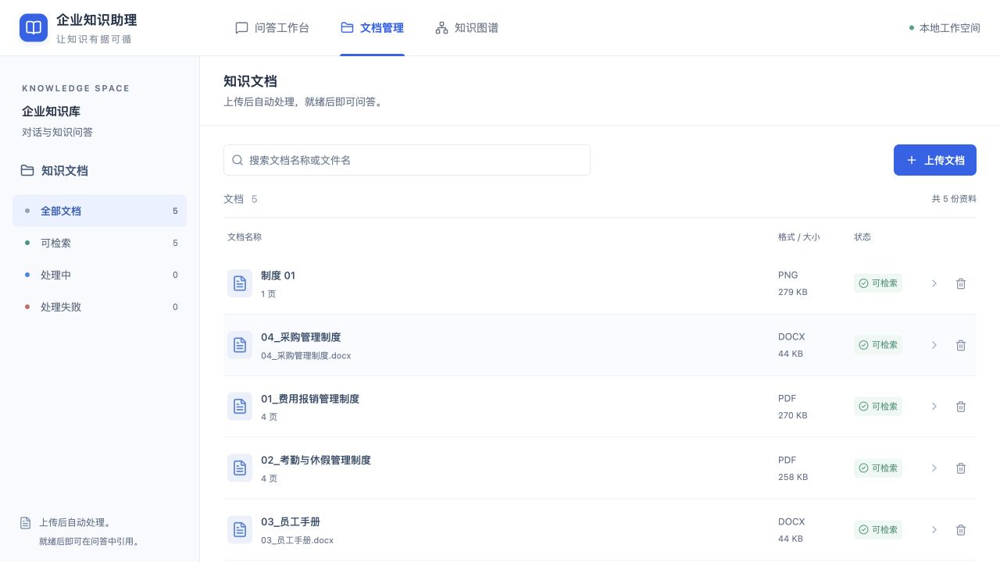
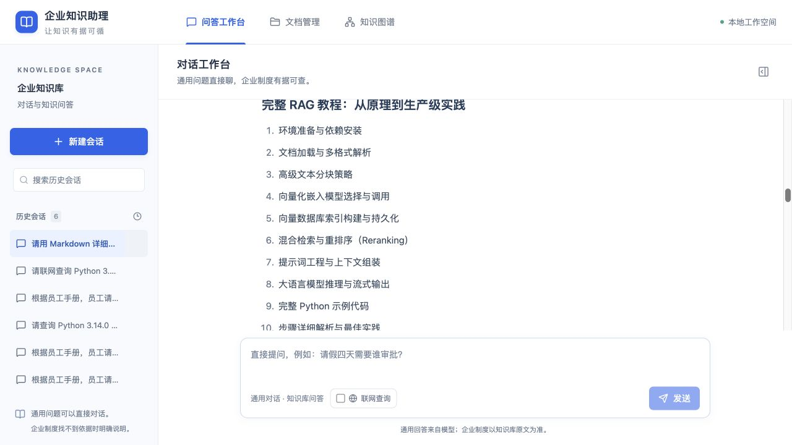

# 交付前必要功能与验收

日期：2026-11-15。用户要求临近交付，优先补必要功能，其余暂缓。本轮沿用现有工作区，不提交 Git，不调整私有模型/追踪配置，不清空已有语料、图谱或演示会话。

## 文档删除

增加 `DELETE /api/documents/{id}` 和列表删除按钮/确认窗口，复用 `deleted_at`，没有数据库迁移。活跃导入或图谱任务返回 409；重复删除返回 204。删除后文档不再出现在列表、后续检索、图谱范围或有效库指纹检查中。

原件、解析产物和历史切块保留。历史回答使用固定的已就绪 import job 读取正文、资源和切块，来源面板标明“已从知识库移除”；不允许对已删除资料重新处理。只凭默认版本请求正文仍为 404，避免把删除视为继续公开的有效知识。

真实 PostgreSQL 集成测试覆盖删除排除、查重释放、历史答案/原件/正文/切块保留、活跃任务阻止、幂等及重试禁止。浏览器使用专用 `交付删除验收.md` 验证取消与确认删除；结束后恢复为原有五份可检索资料。

## 桌面界面

- 有文档时去掉大幅引导区，搜索与上传同排；1280×720 下五条资料均可见。
- 1100 像素以上、较矮桌面缩减图谱顶部和画布高度，1280×720 下画布完整落在首屏，无页面横向溢出。
- 流式、停止及失败草稿使用 Markdown 排版，保留标题/列表/代码；未完成内容禁用链接与引用，完整答案仍经过后端引用校验。
- 浏览器复查 Word 原件、PDF 翻页、制度图片，以及真实增量输出、停止和刷新后从历史恢复草稿。

## 真实问答验收

新增 [最小评测运行器](../../backend/scripts/evaluate_delivery.py)、[20 题样本与完整报告](../../eval/README.md)。只将问题发送到真实 SSE API，标准答案留在评测端。记录完整回答、来源、检索详情、耗时和增量次数；每题独立会话，仅清理脚本创建的会话。

首轮基本检查 15/20，发现部分问题过度澄清、一项检查要求了问题未询问的事实，以及引用格式波动。修复路由提示后，整轮复跑 19/20。最后一题模型返回 `citations: [1, 2]`，原来仅接受对象；现在先规范化数字列表，再继续校验有效编号、正文引用和原文，单题复验 1/1。

校验仍拒绝缺失、越界、布尔/字符串编号、错误引文及无引用；不将所有召回片段自动当成已引用来源。生成提示明确：原文没规定专项审批岗位时，不用财务/人力资源等相邻职责补编。逐题核对由开发助手完成，报告清楚标记复验题；这不是独立人工验收，也不是完整 50 题准确率。

## 检查与运行状态

- 后端含真实基础设施集成测试：294 项通过；前端：63 项通过；TypeScript/Vite 构建通过。
- Ruff 无错误；Alembic 无新增迁移；API ready，PostgreSQL/Redis/RustFS/Neo4j 正常，Worker ping 为 pong。
- Worker/Beat 已更新为本轮应用代码。本机构建复用已验证的本地依赖镜像及离线 wheel；仓库常规 Dockerfile 仍是干净环境的启动方式。
- PDF/图谱懒加载包仍有大于 500 KB 的构建提示，属于已知体积优化项，本轮暂缓。

真实临时 Markdown 首次在 Worker 的 Embedding 阶段遇到 TLS 连接中断。宿主机问答调用正常；容器模型请求和直连 HTTPX POST 对照确认并非凭证缺失。未更改全局或项目代理；手动重试后第二次任务成功，文档达到 ready。该结果验证失败恢复，不代表外部网络已永久稳定。录屏前检查模型连通，遇到同类波动使用“重试处理”；已有五份资料可继续演示。

## 交付安排

[README](../../README.md) 已补当前能力、启动与验收入口；[演示脚本](../demo-script.md) 包含 15～20 分钟讲解流程和一份独立上传样例。当前必要功能收尾完成，下一步按脚本彩排与录屏。完整 50 题、MCP、限定文档范围、复制回答暂缓，避免交付前扩大变更。
