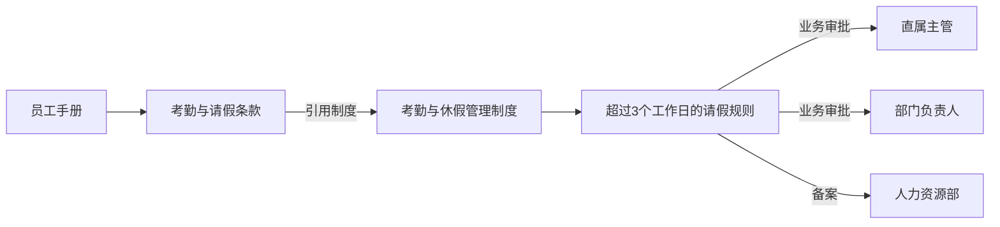

# 知识图谱小样验证

2026-11-15。对应增强待办第 6 项的第一个检查点，本轮产出是可行性证据与可点击小样，没有接入正式图谱页面或自动多跳问答。

结论：可以继续实现带原文校验、条件保留和失败隔离的有限图谱。必须保留“规则”节点，审批、审核、备案和通知分别建关系；当前样本还不能证明无校验的全自动抽取可靠。

## 输入与范围

- 使用同套 `version_chatgpt` 语料的员工手册和考勤与休假管理制度。员工手册读取当前应用库已发布的实际索引；考勤 DOCX 在独立 `knowledge_assistant_test` 数据库中通过真实 MinerU、切块和向量索引流程处理。
- 两份文档分别产生 16、17 个切块，抽样 6 个实际切块。按原有字符/表格行定位拆出 22 个条款单元，保留源文件 SHA-256、document/version/job/chunk 标识、章节和定位信息。DOCX 解析未提供的页码不补造。
- 关系限定为业务审批、备案、审核、通知、所需材料、引用制度。程序根据关系枚举确定节点类型，事项名称取自原文章节或条款标题，减少模型自由命名造成的不稳定。
- 表格首列的适用范围由程序原样附加，条件必须是原文子串；时间数值、否定、事前、返岗后、最迟等检查失败时拒绝该条结果。引用的完整条款或表格行及周边切块也保存，不把若干条件文本擅自解释为可执行的 AND/OR 公式。

## 抽取与独立核对

先执行两轮初版抽取，再用简化后的输出结构执行两轮。原始响应全部保存，没有手写关系替代模型输出。最终的确定性事项命名和时序校验复用了后两轮原始响应，不额外重抽来挑选结果。

| 阶段 | 第一轮 | 第二轮 | 发现 |
| --- | --- | --- | --- |
| 初版 | 11 条规则、13 条关系；预设 11 项中通过 6 项 | 10 条规则、12 条关系；通过 6 项 | 模型混用实体类型、缺失必填字段，全部被拦截。 |
| 固定关系并由程序生成类型 | 18 条规则、24 条关系；预设 11 项全部通过 | 14 条规则、21 条关系；通过 10 项 | 复测的部分事项名称变成了整段原文，触发长度校验。 |
| 原文确定事项名称，补充时序检查 | 18 条规则、24 条关系；12 项通过 12 项 | 16 条规则、23 条关系；12 项通过 11 项 | 额外人工复核发现远程办公遗漏“事前”，加入第 12 项回归并拒绝该条结果。 |

最终两轮保留的类型化关系有 23 条重合、并集 24 条，Jaccard 为 95.8%。这是小样复测的一致性，不是通用抽取准确率；遗漏一条仍表示需要保留严格校验和检查点。

人工逐条核对第一轮结果后，另排除一条“向人力资源部提出考勤异议 → 通知”的关系：提交核查与通知并非完全同义。规则原文保留，该关系未入图。原文子串匹配只能证明出处存在，不能替代语义核对。

关键案例涵盖：

- 手册引用考勤制度；外部培训引用报销/采购制度，但没有明确培训审批人时不补造角色。
- 补卡超过时限或次数时提交书面说明，由部门负责人和人力资源部审核，不能改成业务审批。
- 年休假的 3/5/10 个工作日申请时限；连续病假超过一天的医疗证明。
- 不超过一天、超过一天至三天、超过三天的不同审批档位。
- 人力资源部备案不替代审批；负责人本人不能自行审批。
- 紧急通知不等于已批准，并保留返岗后补办时限。
- 请假最小单位为 0.5 小时，保留法律例外；远程办公需事前批准。

本轮没有验证报销金额区间，也未验证任意领域、任意制度下的效果。

## Neo4j 真实投影与路径

用人工核对后的第一轮结果投影到独立 `run_id` 的临时 Neo4j 命名空间：43 个节点、59 条关联，其中 18 个规则节点、23 条复核后的业务关系；另外 36 条是文档包含规则、事项对应规则等结构关联，不能算作额外模型事实。

5 个制度节点中，2 个有本次处理来源，3 个仅表示原文明确引用的报销、采购或薪酬制度，不代表被引用制度已完成处理或已获得其具体规则。

相同快照投影两次均为 43 个节点、59 条关联，验证了该小样的幂等写入。使用固定参数化 Cypher，从员工手册实际引文定位考勤制度，再找到“超过3个工作日”这一原始表格范围，得到：

| 关系 | 目标 |
| --- | --- |
| 业务审批 | 直属主管 |
| 业务审批 | 部门负责人 |
| 备案 | 人力资源部 |

对应原文：

> 超过3个工作日 | 直属主管 → 部门负责人审批 → 人力资源部备案 | 人力资源部仅备案和核验，不替代前述业务审批。连续休假10个工作日及以上，至少提前10个工作日申请。

这是来源路径验证，尚未实现自然语言问题的图谱召回、自动数值判断或图谱辅助回答。正式接入时不使用模型生成任意 Cypher，图谱失败继续保留现有 RAG 问答。

## 附带修复：MinerU 下载网络路径

隔离导入时复现：默认环境代理路径访问 MinerU CDN 报 `ConnectError`，同一归档直连 HTTP 200；官方查询 API 直连也正常。MinerU 客户端现沿用已有 `KH_MODEL_TRUST_ENV`，默认直接连接，需要代理时可显式开启；三方回答模型仍使用其独立网络设置。

失败任务复用了已有远端 batch 和解析检查点，受控重试后完成真实下载与索引。新增直接/代理配置两项回归测试，并重建 Worker/Beat；运行容器实测默认不继承代理。未修改私有 Token 或全局代理配置。

## 验证与清理

- 后端 207 项、前端 46 项测试通过，Ruff 和 Alembic check 通过；本轮未修改正式前端代码。
- 小样校验包含 1 个合法样例和 4 个篡改/缺失校验：数字凭空变化、遗漏否定、目标不在同条原文、非法关系类型均被拒绝。
- 独立 HTML 预览在 1280×720 电脑窗口核对，无横向溢出；点击制度引用或备案关系可切换对应实际引文，浏览器未观察到控制台错误或警告。
- 临时 Neo4j 的 43 个节点及 59 条关联、隔离测试库中的 1 份考勤文档及 2 个存储对象均按登记 ID/前缀清理。原员工手册版本指纹校验通过。执行期间应用库另外新增 3 份文档，均保留；会话和消息数量未减少。
- 证据位于被忽略的 `.local/graph-spike/`：`inputs.json`、各版原始模型响应、校验结果、`graph.json`、`neo4j-proof.json`、`state.json` 与 `graph-preview.png`。可点击预览是 `preview/index.html`，数据和脚本均内嵌，可作为独立 HTML 文件打开；它是验证产物，不是正式应用入口。

下一步按现有任务表接入正式图谱任务、Neo4j 查询接口和现有 ECharts 页面，再做受控的跨文档证据扩展。保留固定关系集合、原始适用范围、检查点与单条失败隔离，不扩展为通用图谱平台。

## 后续正式接入

2026-11-15 已在本小样结论基础上接入正式任务、接口和页面，并保留四份制度的真实图谱。此文中的小样数量及临时数据清理结果属于历史验证；当前能力和最新验收见 [正式图谱记录](knowledge-graph.md)。
