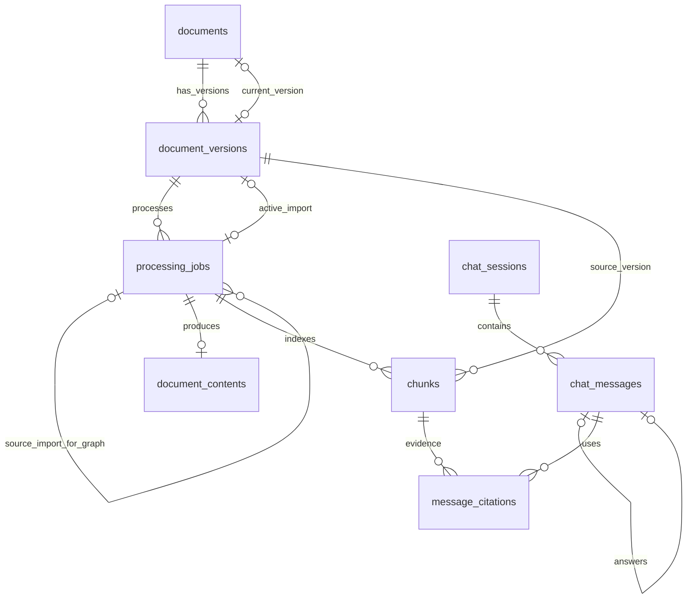
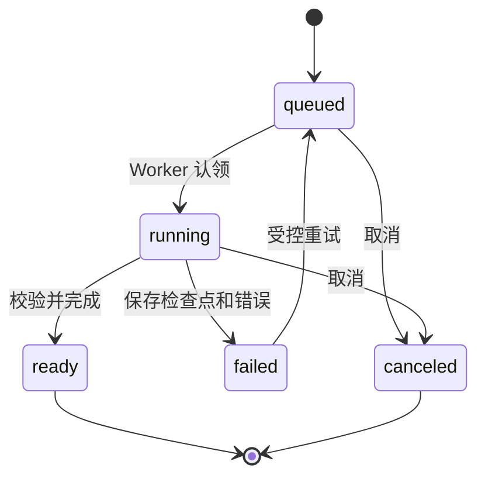
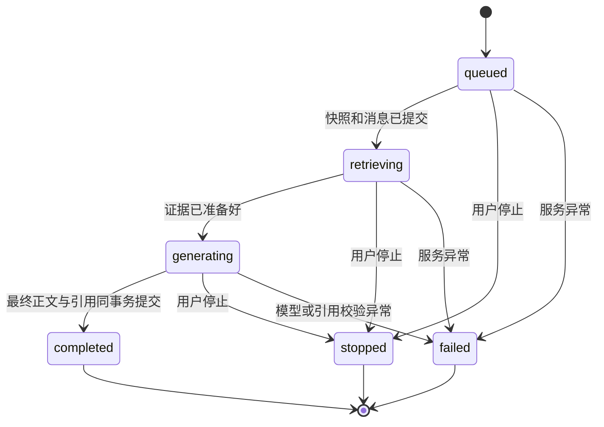

# 企业知识助理：8 张核心表设计

本文说明当前 8 张 PostgreSQL 业务表、引用快照与事务边界。精确字段、CHECK、外键和索引以 [ORM](../../../backend/app/models.py) 和 [Alembic 迁移](../../../backend/migrations/versions/) 为准；整体链路见 [架构说明](../../design.md)。

底层保留分类、版本和会话范围字段，以兼容已有数据及固定引用；当前前端按单文件管理，不提供分类、版本管理或指定文档问答入口。

## 1. 八张表及存储职责

| 表 | 保存什么 | 支撑的前端功能 |
| --- | --- | --- |
| documents | 文档标题、分类、当前版本、软删除状态 | 文档目录、搜索；分类字段保留兼容 |
| document_versions | 原件版本、文件位置、已发布索引指针 | 文件查看、版本与历史原文 |
| document_contents | 每次导入生成的 Markdown、内容块与资源清单 | 正文预览、解析结果、来源定位 |
| chunks | 不可变切片、章节/页码、定位与向量 | 检索、问答、引用、图谱来源 |
| processing_jobs | 导入/图谱任务、阶段、检查点、重试和投递时间 | 上传进度、失败重试、图谱构建状态 |
| chat_sessions | 会话标题、当前问答范围、消息序号 | 新建会话、历史搜索；范围字段保留兼容 |
| chat_messages | 问题、回答、生成状态、每轮资料快照 | 对话恢复、流式回答、停止生成 |
| message_citations | 最终引用的切片、原文片段与展示快照 | 引用编号、页码、版本与原文溯源 |

PostgreSQL 16 + pgvector 保存以上数据；RustFS 保存原件和解析归档；Redis/Celery 负责传递后台任务；Neo4j 保存实体关系。Neo4j 不计入 PostgreSQL 表数，图谱仍使用 ECharts 展示。

首版只运行一个知识库，名称与模型配置从应用配置读取，不额外建立知识库、分类、用户或权限表。资料增多通过索引、分页和任务队列承载，不以固定四份文档为限制。

### 简化边界

| 原来独立拆表的内容 | 本版放在哪里 |
| --- | --- |
| 文档分类 | documents.category 字符串；分类目录由有效文档聚合 |
| 内容块、块与切片的关联 | document_contents.blocks 与 chunks.locators JSONB |
| 文档任务、图谱任务、待投递记录 | processing_jobs；job_type 区分类型，任务行本身也是待投递依据 |
| 会话选择的文档集合 | chat_sessions.scope JSONB |
| 问答轮次、每轮资料范围与模型参数 | 一条助手消息及其 request_snapshot JSONB |
| 单独的上传请求日志 | 新建文档使用稳定 document_id；版本文件 hash 与任务身份处理重试，不提供通用请求审计表 |

明确保留：原件版本、每代切片和最终引用。明确后置：多知识库、任意分类树、独立投递事件历史、通用请求日志、全量审计、在线向量模型切换。

## 2. ER 图



发布指针可为空。图中的 answers 表示助手答复一条用户消息；角色、任务类型和 ready 条件由服务验证，不把外键存在等同于业务正确。

## 3. 字段与约束

### 通用规则

- ID 为 uuid，由应用生成，对外返回字符串。新建上传的 document_id 由客户端生成一次并在重试时沿用，用户不需要手动填写 ID。
- 时间使用 timestamptz，入库存 UTC。created_at 默认 now()；updated_at 由服务更新，不假设普通 UPDATE 自动更新时间。
- JSONB 保存有明确 schema 的可变结构。状态、分类、外键、排序和常用查询条件使用普通列；JSONB 中的 ID、引用范围与业务含义由服务校验。
- 原件与已完成导入的正文/切片不可原地覆盖；重新解析、切片或建向量生成新的 import job。普通重试沿用 job_id。
- 页码从 1 开始，两端同空或满足 1 <= start <= end；DOCX/MD 没有可靠页码时为 NULL，保留章节和内容块定位。
- hash 为 SHA-256 小写十六进制。发布前校验向量齐备、维度正确、所有切片可定位。列表接口不读取完整正文、块清单和向量。
- 外键使用 ON DELETE RESTRICT；文档和会话先软删除。首版不自动物理删除历史版本、任务、正文、切片和引用。

### 3.1 documents：文档元数据

| 字段 | 含义与规则 |
| --- | --- |
| id | 文档稳定身份，更新文件不换 ID |
| title、category | 显示名与分类；标题可重名，分类默认“未分类” |
| current_version_id | 当前供新问答使用的版本；首次处理未完成时为空 |
| next_version_no | 默认 1，锁定文档行后分配版本序号并递增 |
| revision | 元数据修改的乐观并发版本，默认 0 |
| deleted_at、created_at、updated_at | 软删除与元数据时间 |

复合外键保证 current_version_id 属于这份文档；发布服务另查该版本是否已有 ready 的导入任务。分类字段保留在模型中，当前没有分类重命名界面。

### 3.2 document_versions：原件版本

| 字段 | 含义与规则 |
| --- | --- |
| id、document_id、version_no | 原件版本身份及上传顺序；同文档 version_no 唯一 |
| version_label | 原件标注的版本，如 1.1；与上传序号分开 |
| original_filename、format、size_bytes | 文件名、pdf/docx/md/png/jpg、字节数（JPEG 统一为 jpg） |
| file_sha256 | 数据库保证同文档 hash 唯一；上传服务另按全库文件指纹检查，阻止有效文档间重复导入 |
| file_ref | JSONB：bucket、object_key、mime_type；不保存临时签名 URL |
| source_metadata | JSONB：归口部门、原文日期等有 schema 的来源元数据 |
| active_import_job_id | 本版本当前可用的导入结果；重建中保留旧指针 |
| next_generation_no | 锁定版本行后分配任务代次；导入和图谱共用递增序号，允许空号 |
| created_at | 原件登记时间 |

原件对象与 hash 创建后不可改写。current_version/active_import_job 是系统选定的检索版本，不据上传先后推断制度的实际生效优先级。

### 3.3 document_contents：正文与解析块

每个 import job 一行，以 job_id 为主键，version_id 必须与所属任务一致。

| 字段 | 含义与规则 |
| --- | --- |
| job_id、version_id | 明确是哪次导入、哪个原件版本的正文 |
| markdown、content_sha256 | 完整规范化正文及 hash |
| blocks | JSONB 数组：block_id、type、text、heading_path、页码、bbox 或表格结构 |
| artifacts | JSONB：原始解析归档与资源的 bucket/key/hash 清单 |
| page_count | 真实 PDF 页数，单张图片为 1；DOCX/MD 无可靠分页时为空 |
| created_at | 产物创建时间 |

正文与列表元数据仍分表。块 ID 在同一 job 内稳定，切片 locators 引用这些块；这里不需要逐块独立检索/更新，所以首版不拆 content_blocks 与关联表。需要读取某页时按 job 与页码定位，不在文档目录加载 blocks。

### 3.4 chunks：切片与向量

| 字段 | 含义与规则 |
| --- | --- |
| id | UUIDv5(job_id, `chunk-v1:{ordinal}`)，同任务重试稳定 |
| job_id、version_id、ordinal | 代次、原件与顺序；同 job 的 ordinal 唯一 |
| content、content_sha256 | 非空切片与 hash；表格切片保留表头和适用条件 |
| heading_path、page_start、page_end | 章节和真实页码 |
| locators | JSONB 数组：来源 block_id、实际页码、bbox、块内范围；跨页可多项 |
| embedding_profile_hash、embedding_dimension | 向量空间和实际维度，与所属导入任务一致 |
| embedding | pgvector vector，可在处理中暂空；非空时 CHECK 维度一致 |
| created_at | 切片创建时间 |

复合外键将 job/version/profile/dimension 绑定在一起；graph job 没有向量 profile，因此不能作为 chunks 的向量来源。ready 的 chunks 不重写，历史引用直接依赖 chunk_id。

当前默认向量模型为 qwen3.7-text-embedding-flash、1024 维，实际以配置及导入 profile 为准。首版使用精确 cosine 距离验证正确性，数据增长后对确定维度/profile 添加 HNSW 表达式索引，并验证范围过滤后的召回率。维度相同不代表不同模型的向量可混排。

### 3.5 processing_jobs：统一任务表

| 字段 | 含义与规则 |
| --- | --- |
| id、version_id、generation_no | 任务身份、来源原件与版本内递增代次 |
| job_type | import / graph，使用不同处理器，共用 documents 队列 |
| source_job_id | graph 必须指向同版本的 ready import job；import 必须为空 |
| status、stage | 通用任务状态和具体处理阶段，见第 5 节 |
| config、config_hash | 不含密钥的解析/模型/切片或图谱配置快照及 hash |
| embedding_profile_hash、embedding_dimension | import 必填，graph 为空；graph 使用 source_job 的切片 |
| checkpoint | JSONB：远端任务 ID、提交状态、产物位置、阶段计数；graph 另存已校验的抽取结果/manifest/hash |
| attempt_no、max_attempts | 故障尝试次数和上限，默认 0 / 3；正常分批续跑不增加尝试次数 |
| lease_owner、lease_token、lease_expires_at | Worker 租约及单调递增令牌，防止过期 Worker 覆盖 |
| next_dispatch_at、last_dispatched_at、dispatch_attempts | 下次投递时间、最近成功投递时间、投递次数 |
| error | JSONB：code、message、retryable、stage；不写入密钥和完整异常环境 |
| started_at、finished_at、created_at、updated_at | 任务时间 |

同一原件版本最多一个活动 import；同一 source_job 最多一个活动 graph。新索引可以与旧索引的图谱任务并存，不能因为图谱处理中而阻止文档发布。

任务行本身兼作待投递记录，Redis 不是任务状态的唯一存储；不另建 outbox，不记录每次投递的独立历史。请求与任务也不强行一一对应：相同文档/hash/profile 的普通重复上传可以复用同一任务；强制重建明确创建新 generation。

### 3.6 chat_sessions：会话与范围

| 字段 | 含义与规则 |
| --- | --- |
| id、title | 会话身份与标题，默认“新会话” |
| scope | JSONB：mode=all/custom、document_ids；默认 all 和空数组 |
| scope_revision | 每次修改范围递增，避免发送时使用过期选择 |
| next_message_seq | 默认 1，事务内为一对问题/回答分配两个序号 |
| last_message_at、deleted_at、created_at、updated_at | 历史排序、软删除与时间 |

all 表示每次提问时解析当前可用文档，不固定为创建会话那天的清单。custom 必须是非空、去重且有效的文档 ID 集合；被移除的文档显示不可用，不自动扩大到全部知识库。JSONB 中 ID 的存在与范围语义由服务校验。

### 3.7 chat_messages：消息，同时承载一轮问答

| 字段 | 含义与规则 |
| --- | --- |
| id、session_id、sequence_no、role | 消息身份、会话顺序、user/assistant |
| reply_to_message_id | assistant 指向同会话的 user；一条用户消息最多一条助手消息 |
| client_request_id | assistant 保存本次请求的客户端 UUID；同会话唯一，重试返回既有消息 |
| content | Markdown 文本；助手可保存流式片段，最终来源另从引用表组装 |
| status、answer_kind | 生成状态；完成回答分 answered / partially_answered / refused |
| request_snapshot | assistant 的本轮资料清单、profile、尝试编号、执行模式、阶段与检索详情 |
| error、usage | JSONB：错误摘要与供应商实际返回的用量 |
| lease_expires_at、stop_requested_at | 请求存活检查和停止请求 |
| created_at、updated_at | 消息时间 |

user 必须为 completed，reply_to/client_request/snapshot 为空；assistant 必须具备这三项。外键保证答复不跨会话，服务再检查目标角色是 user。每个会话最多一个 queued/retrieving/generating 助手消息，防止追问并发混入历史。

助手消息 ID 就是生成请求 ID，不再拆 chat_turns。客户端保存 client_request_id；同键不同问题或联网选择返回 409；显式重试增加 retry_attempt，并复用原消息身份。

### 3.8 message_citations：最终引用

| 字段 | 含义与规则 |
| --- | --- |
| id、message_id、chunk_id | 引用身份、助手消息、真实切片 |
| citation_no | 回答中的编号，从 1 开始；同消息内唯一 |
| quote | 可在对应切片中核对的实际引文 |
| source_snapshot | JSONB：文档/版本/任务 ID、标题、版本标注、章节、页码与必要定位 |
| created_at | 引用创建时间 |

保留独立引用表，外键阻止误删已引用的切片。服务检查消息为 assistant，chunk.job_id 属于 request_snapshot 的资料清单，快照字段确实来自该 chunk/version，编号确实被最终正文使用。不能将 JSONB 中的自报来源或全部召回结果直接当作最终引用。

## 4. JSONB 的结构与校验责任

JSONB 是合并存储，不是取消数据约束。服务使用 Pydantic 定义各字段的结构，在写入和恢复时校验；数据库检查对象/数组基本形状。检索详情使用 details.version 标识结构版本；其余快照字段按实际服务序列化结构维护，不把设计示例当作接口契约。

### 4.1 解析块与切片定位

blocks 中每项包含 block_id、type、text、heading_path、page_start/page_end；可选 structured_content 保存表头/行，locators 保存按页的 bbox。bbox 保留解析器原始信息，不假定单位或将不同解析器坐标直接混用。

chunks.locators 引用同 job 的 block_id，可带块内 Unicode 码点半开区间和按页 bbox。发布服务校验引用块确实存在，范围与页码合理；一块可贡献给多个切片。跨页表格保留上下文和适用条件。

### 4.2 会话范围与每轮快照

```json
{
  "mode": "custom",
  "document_ids": ["11111111-1111-4111-8111-111111111111"]
}
```

mode=all 时 document_ids 必须为空；custom 时必须非空且去重。数据库只检查 JSON 形状与 mode 值；UUID 格式、文档存在性和可用性由服务验证。

assistant.request_snapshot 随实际阶段更新：

- `documents` 固定检索开始时可用的 document_id、version_id、job_id，`profile_hash` 标识向量空间；没有知识库检索时资料清单为空。
- `attempt_no`、`web_search_requested`、`transport` 区分尝试编号、联网选择与 SSE 请求；旧尝试不能覆盖新结果。
- `answer_mode`、`stream_phase`、`stop_reason` 描述实际执行模式、阶段与停止原因。
- `details` 保存意图、召回/重排、图谱路径、网页来源、Trace ID 与耗时；`warnings` 保存降级说明。已有历史消息缺失这些信息时不补造。

实际字段由 [聊天服务](../../../backend/app/chat/service.py)、[流式状态](../../../backend/app/chat/stream_state.py) 和 [检索快照](../../../backend/app/retrieval/search.py) 生成，不接收客户端自报的资料快照，也不保存密钥。

当前部署固定一个向量空间。更换模型或维度后需要重建并发布兼容索引，再恢复查询；维度相同也不能把不同模型的向量混排。

### 4.3 引用快照

source_snapshot 包含 document_id、version_id、job_id、document_title、version_label、heading_path、page_start/page_end 和必要的 locators。它保存当时的展示信息；来源是否存在以 chunk 外键和所属版本为准。

服务从已固定的 job 清单读取 chunk，再组装快照、校验 quote 和编号；不接受客户端提交的快照作为证据。精简后，数据库不再用轮次关联表约束 JSON 中的范围，因此这项服务校验必须测试，不能直接省略。

## 5. 后台任务与发布

### 5.1 通用状态、具体阶段与界面标签



| 类型 | running 内的阶段 | ready 的含义 |
| --- | --- | --- |
| import | parsing → chunking → embedding → publishing | 正文、定位和向量齐备，结果已完成发布判断 |
| graph | extracting → validating → projecting | 校验后的抽取结果已写入 Neo4j 并核对完成 |

新任务初始为 queued/stage=queued；正常延后轮询可以保持 queued/parsing 等当前阶段；ready 的 stage=done。failed/canceled 保留当时 stage 便于诊断。API 将 import 的 running+stage 映射为现有“解析文档/生成切片/建立索引”等状态；两个任务类型不需要两个任务表。

### 5.2 上传去重与版本身份

- 新建上传：客户端为这次新文档生成并保留一个 document_id，POST /api/documents 提交文件及标题/分类。请求丢失后重试使用同一 ID。
- 已有相同 ID 与相同原件 hash 时，返回既有版本与相同配置的已有任务；同一 ID 的新建请求携带不同文件则返回 409，不暗中创建新版本或覆盖文件。不把不同文件暗中视为元数据更新。
- 新增前检查：POST /api/documents/check-duplicate 接收 file_sha256，查询未软删除文档的全部历史版本，返回 duplicate 和既有文档/版本身份。文件改名不改变指纹；跨格式、重新导出或仅正文相同的不同字节不做语义去重。重复文件跳过导入，展示已有文档信息；首版不提供绕过去重的“仍然新建”。同批次同指纹只保留第一份。
- 更新文件：显式 POST /api/documents/{document_id}/versions。同文档同 hash 复用版本；不同 hash 也先做全库检查，若命中其他有效文档则返回已有文档，不创建版本，否则分配新 version_no。已软删除文档不占用有效库的指纹，可以重新导入；历史数据仍保留。
- 预检查只是用户反馈。正式上传时服务必须用实际接收字节重新计算 SHA-256，在 READ COMMITTED 事务中先调用 lock_and_check_file，以指纹前 64 位取得 pg_advisory_xact_lock，锁保持至文档/版本/任务登记提交或回滚。相同文件的所有写入入口遵循此边界；命中即复用返回，不写新文档、版本或任务，也不发起解析/向量调用。新建接口同一 ID 的不同文件冲突检查优先，继续返回 409。
- 前端和接口查询故障均明确报错，不能按“未找到重复”继续。新增 ix_versions_file_sha256 非唯一索引支持跨文档查询；数据库保留原有同文档唯一约束以兼容历史记录，全库上传规则由共享事务边界执行。
- 创建或复用 job 时锁住版本行，普通重复上传复用相同 config 的 ready/活动 job；强制重新解析/索引才分配新 generation_no。
- 若相同配置仅有 failed/canceled 任务，普通重复上传返回既有终态，不自动创建任务或重置尝试次数；可恢复的 failed 走显式 retry，达到上限或需要重新构建时才创建新 generation。
- 原件先保存到新 RustFS 对象键，再在 PG 事务内创建文档/版本/任务。PG 失败产生的未引用对象按隔离前缀和保留期清理，不覆盖旧原件。

这实现首版上传重试和重复文件处理，不承诺一张跨业务的通用请求审计日志。ID 由客户端代码维护，不增加用户操作步骤，也不作为权限凭证。

### 5.3 用任务表恢复投递

1. 创建任务与业务行在同一 PG 事务提交，status=queued、next_dispatch_at=now()。提交后尝试立即投递，周期调度器也扫描到期 queued 行。
2. 投递器锁行，先将 next_dispatch_at 延后并递增 dispatch_attempts，再向对应队列发送 job_id；成功后记录 last_dispatched_at。发送失败或发送前进程退出，都可在下一次到期扫描补发。
3. 若 Broker 已接收但 Worker 尚未认领，可能再次投递；消费者依据 PG 的 job 状态和租约认领，重复消息不能重复启动已完成任务。投递次数与 Worker 的 attempt_no 分开。
4. running 租约过期时，恢复器条件更新为 queued、增加 lease_token、清理旧 owner/租约并保留检查点。新 Worker 认领再取新 token；旧 Worker 的写入/发布必须被条件更新拒绝。
5. 业务处理失败记录 error 和 retryable，按上限决定受控重试。Broker 不可用保持 queued 并显示投递错误，不伪装成“知识库无依据”。

任务行可以承担待投递角色，因为每一行只代表一个业务任务，允许重复投递同一个 job_id；首版不需要逐次投递事件审计。调度器采用行锁与 SKIP LOCKED，投递间隔设上限，不能在长事务里等待远端服务。

### 5.4 解析、索引与发布

- checkpoint 保存 MinerU remote_task_id、submission_state、产物引用和已完成阶段；有远端任务 ID 就继续查询。提交结果 uncertain 时明确报错并核实，不能直接二次付费提交。
- staging 正文和切片按 job 隔离，重试使用稳定 ID。每次提交检查 lease_token 与状态；ready 后不重写。
- 跨文档/版本/任务的事务统一按 document → version → job 顺序锁行，校验当前租约、正文、块定位、非空向量、profile 和计数。成功后标记 ready/stage=done，再按 generation_no 更新 active_import_job_id；按 version_no 更新 current_version_id，较旧的迟到任务不能倒退指针。
- active_import_job_id 的 FK 只验证版本归属，服务还必须验证目标 job_type=import 且 ready。文档软删除时不发布新结果。
- 原件更新或同版本重建过程中，旧的发布指针继续可用；失败不将已有可用文档降级。
- 索引完成后不自动抽取图谱。用户通过 POST /api/graph/build 按需创建或复用 graph 任务，source_job_id 绑定已发布 import；重复请求不重复创建相同任务。

### 5.5 图谱结果与 Neo4j

graph 的 source_job_id 必须是同版本的 ready import，服务验证这一类型规则。抽取只使用该 job 的切片；checkpoint 保存校验后的 result/manifest/hash，投影失败时重放相同结果，不重新调用模型抽取。

Neo4j 使用 Document、Matter、Rule、Role、Material 等节点和有来源的关系。规则与边采用包含任务及租约令牌的不可变 projection_id，文档/岗位等实体可以共享；图谱来源通过 PostgreSQL 的固定 job/chunk 和 locator 回查。

每批抽取校验后保存检查点；投影失败复用结果，不重新调用模型。Neo4j 参数化事务按 namespace/id 保持幂等，PostgreSQL 仅发布仍持有效租约且来源有效的结果。读取排除旧导入和已删除来源，不设置额外业务表。

画布最多展示 80 个节点，图谱接口最多返回 1000 节点/5000 边，达到限制时提示；收起只改变显示，不删除事实。图谱失败不影响基础 RAG。详见 [知识图谱](../../dev-notes/knowledge-graph.md)。

## 6. 一轮问答的事务规则



1. 按 session_id/client_request_id 查询既有助手消息，校验问题和联网选择；同一请求重放返回已保存状态。显式重试用 retry_attempt 增加尝试编号，总共最多 3 次，复用原 user/assistant 消息。
2. 锁住 session 后检查单活动回答并分配消息序号。首次发消息可同时创建会话，反复新建不会保存空会话。
3. 路由后若为知识问题，检索用一致读事务固定已发布的文档/version/job/profile 清单。空库或无依据返回明确拒答；通用、澄清和联网分支不冒用知识库引用。
4. 检索和模型请求在数据库长事务之外执行。草稿分批落库后才发送 SSE 增量，写入时检查消息终态、当前尝试编号及租约。
5. 完成时锁助手消息，在同一事务校验正文、实际引用、原文与资料范围，再保存正文、引用、answer_kind 和 completed；拒答为 completed+refused，服务故障为 failed。
6. 停止与完成按同一消息串行化；未完成文本没有有效引用，过期旧尝试不能发布。停止还会尝试关闭可取消的上游模型流。
7. 进程中断后将过期活动消息恢复为可重试失败，保留草稿，不自动重发模型；用户主动重新生成沿用同一请求身份。

底层 scope 结构由服务校验，当前聊天默认检索全部有效知识库。文档新版本发布或软删除后，历史引用仍打开固定 version/job 来源；删除规则与对象保留期见 [整体设计](../../design.md#5-文档导入与任务恢复)。

## 7. 约束、索引与前端映射

### 数据库与服务的分工

| 数据库直接约束 | 服务必须校验 |
| --- | --- |
| 当前版本属于本 document | 指向可用版本，版本发布先后正确 |
| 同文档原件 hash 唯一 | 上传入口服务端重新计算文件指纹、全库检查，并持有同指纹事务锁直至登记完成 |
| active import 指针属于本 version | 目标类型 import、状态 ready、产物完整 |
| graph source_job 与本任务同 version | source_job 类型为 import，已完成且来源切片合法 |
| chunk 的 job/version/profile/dimension 组合一致 | blocks/locators 真正对应原文；向量由正确模型产生 |
| 消息答复不跨 session、消息序号/请求 ID 不重复 | reply_to 为 user；request_snapshot 为服务生成的有效范围 |
| citation 的 message/chunk 存在、编号唯一 | message 是 assistant；chunk 属于本轮范围；引文与编号真实有效 |
| JSON 形状、枚举、页码、hash、计数 | JSON 内文档 ID、块 ID、快照字段和引用的语义 |

### 索引

迁移包含文档按时间/分类的列表索引、版本号和 hash 去重、任务认领/投递/租约恢复、最新 ready graph、会话历史、会话内单活动回答、引用反查等索引。唯一约束已覆盖的前缀不重复建索引。

元数据搜索先用带参数的 ILIKE，数据增长后增加 pg_trgm；正文和向量只按当前可用或本轮固定的 job 查询。BM25 缓存按 job 清单和切片配置签名失效。引入 ANN 前验证范围过滤后的召回，不能先全库取少量结果再过滤。

### 当前接口与数据来源

| 功能 | 数据来源与接口 |
| --- | --- |
| 文档列表、搜索 | GET /api/documents，offset/limit 元数据分页，不加载正文或向量 |
| 上传与失败重试 | POST /api/documents/check-duplicate；POST /api/documents；POST /api/processing-jobs/{id}/retry |
| 正文与原件 | GET /api/document-versions/{id}/parsed?job_id=...；GET /api/document-versions/{id}/file |
| 文档删除 | DELETE /api/documents/{id}，排除新检索并保留历史固定来源 |
| 新建、历史与删除会话 | POST/GET /api/sessions；GET/DELETE /api/sessions/{id} |
| 发送、停止与重试 | POST /api/chat/stream；POST /api/chat/stop；同步 POST /api/chat 保留兼容，重试增加 retry_attempt |
| 回答引用 | message_citations → chunks → document_versions；GET /api/chunks/{id} 不返回向量 |
| 图谱生成与读取 | POST /api/graph/build；GET /api/graph，可按 document_id 筛选 |

底层仍保留新版本、重新解析、重建索引和 scope 仓储能力，当前没有范围修改 API 或相应前端入口。浏览器通过原生 fetch 读取 POST SSE，协议详见 [流式与停止](../../dev-notes/streaming-readme.md)。

## 8. 迁移与验证入口

| 迁移 | 作用 |
| --- | --- |
| [0001_core.py](../../../backend/migrations/versions/0001_core.py) / [冻结 SQL](../../../backend/migrations/versions/0001_core.sql) | 创建 8 张业务表、约束和初始索引 |
| [0002_file_fingerprint.py](../../../backend/migrations/versions/0002_file_fingerprint.py) | 增加全库指纹查询索引 |
| [0003_image_documents.py](../../../backend/migrations/versions/0003_image_documents.py) | 格式约束加入 png/jpg，存在图片时拒绝降级缩窄约束 |

后续结构变更新增迁移，不修改已执行的冻结 SQL。数据库另有 Alembic 自带的 alembic_version，不计入 8 张业务表。

回归入口包括 `backend/tests/test_database.py`、`test_migrations.py`、`test_concurrent_storage.py`、`test_chat_storage.py`、`test_document_deletion.py` 和图谱相关测试；命令见 [README](../../../README.md#验证与开发)。真实问答质量与语义核对见 [eval](../../../eval/README.md)，不以数据库约束或测试条数代替回答质量。
